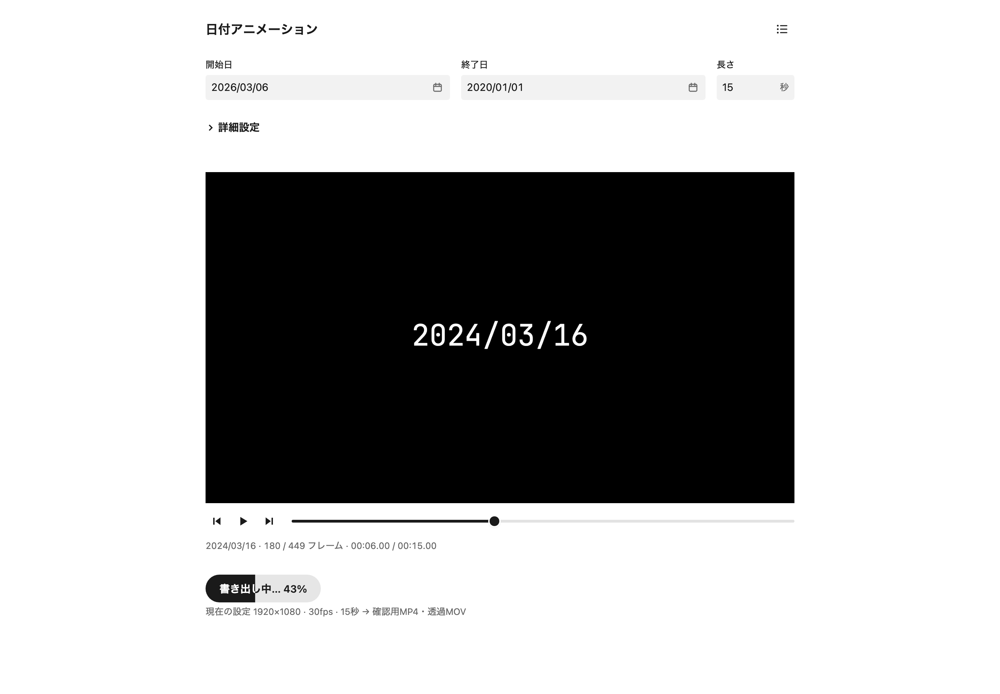
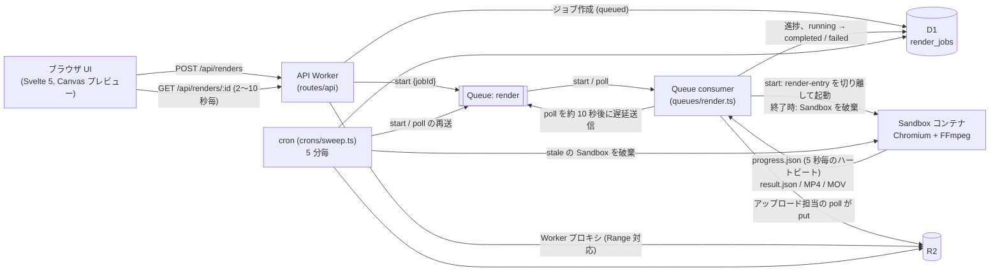

# 日付アニメーション（Date Countdown Studio）

日付が開始日から終了日へ 1 日ずつ進む（または戻る）カウントダウン動画を、ブラウザで編集して書き出すアプリです。
Void（Vite + Svelte 5）で作り、Cloudflare Workers にデプロイします（Worker 名 `time-travel-animation`）。



## 概要

- 開始日、終了日、尺、fps、解像度、イージング、日付の表示形式、フォント、文字サイズ、色、位置を設定し、Canvas でプレビューできます。
- 日付の表示形式は `YYYY/MM/DD`（新規編集の既定）、`YYYY.MM.DD`、`YYYY年MM月DD日` の 3 種類です。月と日は常に 2 桁で表示します。`dateFormat` を持たない保存済みの設定（この項目の追加前に作ったジョブ）は `YYYY.MM.DD` として扱います（`src/lib/renderer/types.ts`）。
- フォントは同梱の 8 書体から選びます：等幅（JetBrains Mono、既定）、ゴシック（Noto Sans JP）、明朝（Noto Serif JP）、丸ゴシック（Zen Maru Gothic）、手書き風（Klee One）、極太（Dela Gothic One）、ドット（DotGothic16）、デジタル（Orbitron のサブセット）。一覧は `src/lib/renderer/fonts.ts` にあります。等幅とデジタルの「年」「月」「日」は Noto Sans JP で補います。すべて SIL Open Font License 1.1 で、出典とクレジットは `assets/fonts/README.md` にあります。
- 書き出しは非同期ジョブで実行し、次の 2 ファイルを作ります。
  - **preview.mp4**：H.264（yuv420p）、黒背景。確認用。
  - **transparent.mov**：ProRes 4444（アルファ付き）、背景透過。編集ソフトでの合成用。
- 完成した MP4 は再生でき、MP4 と MOV はダウンロードできます。成果物の保持期間は 30 日です。

設定の範囲は `src/lib/renderer/schema.ts` が定義しています（尺 1〜60 秒、0.1 秒刻み、fps 24/30/60、解像度 1280x720 または 1920x1080）。

### 画面

| パス | 画面 | 内容 |
| --- | --- | --- |
| `/` | エディター | 開始日、終了日、尺だけを常に表示し、残りの項目は「詳細設定」に折りたたむ。プレビューと「書き出す」ボタンを同じ画面に置く。書き出し中はボタン自体がジョブの状態を表示し（順番待ちは「待機中…」、描画中は「書き出し中… N%」と進捗の塗り）、完了すると「透過MOVをダウンロード」「確認用MP4をダウンロード」のボタンを、失敗するとエラーの内容を表示する |
| `/history` | 書き出し一覧 | 自分のジョブを新しい順に表示する。MP4 の再生、ダウンロード、再試行、期限切れの表示、「エディターに読み込む」（`/?from=<jobId>`）に対応 |

プレビューの背景は常に黒です。
背景は CSS で描き、Canvas 自体は透過のまま描画します。

## アーキテクチャ

描画処理は `src/lib/renderer/` の `renderFrame` 一つだけで、ブラウザのプレビューとコンテナの書き出しが同じコードを使います。
コンテナ側は `scripts/build-container.ts`（esbuild）がこのソースを `container/dist/` にバンドルし、Sandbox イメージに焼き込みます。

Sandbox は R2 と D1 に直接アクセスできません。
そのため Queue consumer（Worker）が Sandbox を操作し、出力ファイルを読み出して R2 に保存し、D1 のジョブ状態を更新します。

Queue consumer は 1 回の実行が 15 分で打ち切られます。
そこで consumer は描画の完了を待たず、Queue の `render` に流れる 2 種類のメッセージ（`src/server/render-messages.ts`）で、短い処理を繰り返してジョブを進めます。

1. **`start`**：ジョブを `queued` から `running` に比較更新（CAS）で確保し、Sandbox 内で `container/render-entry.ts` を切り離して起動する。約 10 秒後に届く `poll` を遅延送信して終了する。
2. **`poll`**：Sandbox の `progress.json` と `result.json` を読み、進捗を D1 に反映して、次の `poll` を約 10 秒後に送る。コンテナは描画中、`progress.json` の `updatedAt` を 5 秒毎に更新する（ハートビート）。
3. `result.json` ができたら、`updated_at` の CAS で選ばれた 1 つの `poll` だけがアップロードを担当し、MP4、MOV、`metadata.json` を R2 に保存してジョブを `completed` にする。
4. `completed` か `failed` になったら Sandbox を破棄する。

重複配信や重複した `poll` の連鎖は CAS で 1 本に収束します。
この方式により、consumer の 15 分上限は動画の長さを制限しません。
手順は `src/server/render-processor.ts`、Sandbox と R2 の操作は `src/server/render-runner.ts` にあります。



| 場所 | 役割 |
| --- | --- |
| `pages/index.svelte`, `pages/history.svelte`, `src/lib/components/` | エディターと書き出し一覧の UI |
| `src/lib/renderer/` | 共有レンダラー（設定スキーマ、日付計算、イージング、`renderFrame`） |
| `routes/api/renders/**` | REST API |
| `queues/render.ts`, `src/server/render-processor.ts` | Queue consumer（`start` / `poll` の処理） |
| `src/server/render-runner.ts` | Sandbox の起動、状態の読み取り、R2 への保存、破棄 |
| `src/server/constants.ts` | 間隔、上限、猶予時間などの運用パラメータ |
| `crons/sweep.ts`, `src/server/sweep.ts` | 再送、取り残しの回収、期限切れ削除、失敗ジョブの掃除 |
| `container/`, `Dockerfile.sandbox` | Sandbox イメージ（Chromium で描画し、FFmpeg でエンコード、ffprobe で検証） |
| `db/schema.ts`, `db/migrations/` | D1 スキーマ（`render_jobs`） |

### 仕様からの差分

- **配信**：署名 URL ではなく、Worker プロキシ（Range 対応）でダウンロードさせる。
- **アップロード**：Sandbox は R2 に書かず、Queue consumer が出力を読み出して R2 に保存する。
- **書き出しの進め方**：consumer が描画の完了を待つのではなく、Sandbox でバックグラウンド実行し、Queue の遅延メッセージでポーリングする。
- **DLQ**：使わない。D1 を状態の真実の源泉とし、取り残しは cron が回収する。
- **書き出し一覧**：エディターと同じ画面ではなく、別ページ（`/history`）に置く。
- **設定項目**：エディターには基本項目（開始日、終了日、尺）だけを表示し、それ以外は「詳細設定」に折りたたむ。
- **プレビュー背景**：仕様 §4.1 の「市松模様 / 黒」の切り替えは、利用者の要望で削除した。背景は常に黒。
- **日付の表示形式**：仕様は `YYYY.MM.DD` 固定だが、`YYYY/MM/DD`（新規編集の既定）、`YYYY.MM.DD`、`YYYY年MM月DD日` から選べるようにした。
- **フォント**：仕様は同梱フォント 1 種類だが、OFL ライセンスの 8 書体から選べるようにした。

設計時の判断の経緯は `claudedocs/design.md` にあります。

## 前提条件

| 項目 | 要件 |
| --- | --- |
| Node.js | 26.13.0（`engines` の範囲は `^24.22.0 \|\| >=26.12.0`） |
| pnpm | 12.18.0（`package.json` の `packageManager`） |
| Docker | **ローカル開発でも必須**。`pnpm dev` が Sandbox イメージをビルドし、ローカルでもコンテナでレンダリングするため |
| Cloudflare | デプロイ時のみ。Workers Paid プランと Containers の利用権限が必要（Sandbox が Containers を使う） |

バージョンは `package.json` の次の 3 か所で固定しています。

- `packageManager`（`pnpm@12.18.0`）：pnpm 本体のバージョン。
- `devEngines.runtime`（Node.js 26.13.0、`onFail: download`）：pnpm がこの Node.js を取得し、`pnpm run`、`pnpm exec`、postinstall をこのバージョンで実行する。
- `volta.node`（`26.13.0`）：Volta を使う場合に、シェルの `node` をこのバージョンにする。

Volta 2.0.2 では pnpm 12 をプロジェクト単位で固定できません。
`volta pin pnpm` は `VOLTA_FEATURE_PNPM` を有効にしないと使えず、有効にすると pnpm 12 に無い `bin/pnpm.cjs` を起動しようとして失敗します。
そのため pnpm はグローバルパッケージとして入れます。

```sh
volta install pnpm@12.18.0
```

pnpm 10 のまま `packageManager` による自動切り替えに任せると、macOS では切り替え先の pnpm 12 を起動できません（`ENOEXEC`）。
また、Volta はグローバルパッケージの子プロセスに、そのパッケージを入れたときの Node.js を渡します。
スクリプトの Node.js を `devEngines.runtime` で固定しているのはこのためです。

pnpm 11 以降は、公開から 1 日たっていないパッケージを解決しません（`minimumReleaseAge` の既定値）。
依存を更新した直後の `pnpm install` がこの理由で失敗したら、1 日待つか、そのパッケージを `pnpm-workspace.yaml` の `minimumReleaseAgeExclude` に加えます。

Sandbox イメージはローカルでも Cloudflare と同じ `linux/amd64` でビルド、実行されます。
Apple Silicon の Mac ではエミュレーションで動くため、ビルドとレンダリングはネイティブより遅くなります。

## ローカル開発

```sh
pnpm install          # postinstall で void prepare が走る
cp env.example .env   # AUTH_MODE=dev を含むローカル用設定
pnpm db:migrate       # ローカル D1 にマイグレーションを適用
pnpm dev              # コンテナをビルドしてから Vite を起動（http://localhost:5173）
```

- テンプレートのファイル名が `.env.example` ではなく `env.example` なのは、`void/env` がルートの `.env.*` を拒否するためです。
- `pnpm dev` は `pnpm build:container` を先に実行します。初回は Docker イメージ（Chromium と FFmpeg を含む）のビルドに時間がかかります。
- 認証は `AUTH_MODE=dev` **かつ** 開発ビルド（`import.meta.env.DEV`）のときだけスキップされ、利用者は `dev@localhost` に固定されます。本番ビルドでは `AUTH_MODE=dev` を設定しても認証はスキップされません。
- スキーマ（`db/schema.ts`）を変えたときは `pnpm db:generate` でマイグレーションを作り、SQL を確認してからコミットします。

### 停止後に残るコンテナの掃除

dev サーバーを止めたあと、名前に `workerd` を含むプロキシ用コンテナ（`workerd-…-proxy`）が残ることがあります。
次のコマンドで確認し、不要なら削除します。

```sh
docker ps -a --filter "name=workerd" --format '{{.Names}}\t{{.Status}}'
docker rm -f $(docker ps -aq --filter "name=workerd")
```

## テスト

| コマンド | 内容 | 前提 |
| --- | --- | --- |
| `pnpm test` | Vitest の単体テスト（`src/**/*.test.ts`, `tests/unit/**`）。レンダラー、UI ロジック、認証、ジョブ状態遷移、`start` / `poll` の処理、sweep など | なし |
| `pnpm typecheck` | `svelte-check` による型検査 | なし |
| `pnpm test:e2e` | Playwright の UI E2E（`tests/e2e/`）。dev サーバーを自動起動し、API はテスト内でモックする | Docker（dev サーバーがコンテナをビルドするため） |
| `pnpm test:container` | 実イメージで短い動画を作り、ffprobe とアルファを検証する（`tests/container/`） | Docker。無いと自動でスキップ |

Playwright のブラウザが未インストールなら、先に `pnpm exec playwright install chromium` を実行します。

### ローカル CLI でのレンダリング

Web UI を通さず、設定 JSON から Sandbox と同じイメージで動画を作れます。

```sh
pnpm render:local <config.json> <outDir> [--no-build] [--platform linux/amd64]

# 2 秒 / 24fps / 720p（短時間で終わる）
pnpm render:local tests/container/fixtures/short.json out/short

# 受け入れ条件の設定（15 秒 / 30fps / 1080p）
pnpm render:local tests/container/fixtures/acceptance.json out/acceptance
```

`<outDir>` に `preview.mp4`、`transparent.mov`、`result.json`（ffprobe とアルファ検証の結果）が出力されます。
イメージは入力（Dockerfile と `container/dist`）のハッシュが変わったときだけ再ビルドされ、`--no-build` でビルドを省略できます。
コンテナは `--network none` で実行されます。

## API

すべての API で認証が必要です。
エラーは `{ "error": { "code", "message", "issues"? } }` の形で返ります。

| メソッド | パス | 主なステータス |
| --- | --- | --- |
| `POST` | `/api/renders` | `202` 作成（`queued`）、`200` 進行中の同一設定ジョブまたは同じ `idempotencyKey` のジョブを再利用（`reused: true`）、`400` 設定不正、`429` 進行中ジョブあり（1 件まで）または 1 時間 20 件超過（`Retry-After: 30`） |
| `GET` | `/api/renders?cursor=&limit=` | `200` 自分のジョブを新しい順に返す（`limit` 既定 20、最大 50、`nextCursor` 付き）、`400` `limit` または `cursor` が不正 |
| `GET` | `/api/renders/:id` | `200`、`404` 存在しない、または他人のジョブ |
| `POST` | `/api/renders/:id/retry` | `202` 同じ設定で新ジョブを作成（元ジョブは残る）、`200` 再利用、`404`、`409` `failed` 以外、または現行スキーマで設定が無効 |
| `GET` | `/api/renders/:id/assets/:format` | `format` は `mp4` か `mov`。`200` / `206`（Range）/ `304`（ETag 一致）/ `416`、`409` 未完了、`404` 期限切れまたは存在しない。`?download=1` で `Content-Disposition: attachment` |

認証と送信元に関するステータスは全 API 共通です。

- `401`：Access の JWT（`Cf-Access-Jwt-Assertion`）が無い、または検証に失敗した。
- `403`：JWT にメールアドレスが無い、または `ALLOWED_EMAILS` に含まれない。
- `403`（`forbidden`）：状態を変える `POST` が同一オリジンでない（`Sec-Fetch-Site` が `same-origin` 以外、または `Origin` が一致しない）か、`Content-Type` が `application/json` でない。ボディの無い `retry` は、`Content-Type` があるときだけ JSON を要求する（`src/server/request-guard.ts`）。
- `503`：`ACCESS_TEAM_DOMAIN` か `ACCESS_AUD` が未設定（`auth_not_configured`）。

`POST /api/renders` のボディは `{ "config": { ... }, "idempotencyKey"?: "..." }` で、上限は 16 KiB です。

### ジョブのエラーコード

`failed` のジョブは `errorCode` を持ち、UI はそれに対応する文言を表示します（`src/server/job-state.ts` の `ERROR_MESSAGES`）。
一覧に無いコードは `render_failed` に丸めます。

| コード | 主な原因 |
| --- | --- |
| `render_failed` / `encode_failed` / `verification_failed` / `invalid_output` | コンテナ内の描画、エンコード、ffprobe 検証の失敗、または `result.json` の不正 |
| `upload_failed` | R2 への保存に失敗した |
| `timeout` | 開始から 2 時間を超えた、またはアップロードが 10 分以内に終わらなかった |
| `stalled` | `progress.json` のハートビートが 3 分以上更新されない |
| `container_lost` | 起動から 3 分を過ぎても `progress.json` が現れない（コンテナが入れ替わった） |
| `stale` | `running` のまま 20 分以上 D1 が更新されず、cron が回収した |
| `sandbox_unavailable` | Sandbox を起動できなかった |
| `invalid_config` | 保存された設定が現行スキーマで無効 |
| `internal` | その他の内部エラー |

## デプロイ

`pnpm deploy` は pnpm の組み込みコマンドなので、必ず `pnpm run deploy` を使います。

```sh
pnpm run deploy   # pnpm build:container && void deploy --platform cloudflare
```

1. 初回はブラウザが開き、Cloudflare へのログインとアカウント選択を求められます。
2. D1、R2、Queue、Container（Sandbox）は Void が自動で作成します。
3. `db/migrations/` の未適用マイグレーションが適用されます。適用前に D1 の復元ポイントが保存され、`void db restore` のコマンドが表示されます。
4. 初回デプロイで生成される `void.lock.json` をコミットします。

### シークレット

本番の値は `void secret put` で設定します（デプロイ時に `.env` はアップロードされません）。

```sh
pnpm exec void secret put ACCESS_TEAM_DOMAIN   # 例: myteam.cloudflareaccess.com
pnpm exec void secret put ACCESS_AUD           # Access アプリケーションの AUD タグ
pnpm exec void secret put ALLOWED_EMAILS       # 許可するメール（カンマ区切り、大文字小文字は区別しない）
```

| 変数 | 本番での扱い |
| --- | --- |
| `AUTH_MODE` | 設定しない（既定の `access`）。Access の JWT を JWKS で検証する |
| `ACCESS_TEAM_DOMAIN`, `ACCESS_AUD` | 必須。未設定の間は **全 API が `503` で拒否** する（fail closed） |
| `ALLOWED_EMAILS` | Access のポリシーに加えたアプリ側の許可リスト。未設定なら Access を通過した全員を許可し、空文字列なら誰も許可しない |
| `R2_RETENTION_DAYS` | 成果物の保持日数。既定 `30` |

シークレット設定前にデプロイしても、上記のとおり API は誰にも使えない状態で始まります。

## Cloudflare Access の設定

Worker は `workers.dev`（`time-travel-animation.<subdomain>.workers.dev`）で公開されます（`void.config.ts` の `workers_dev: true`、プレビュー URL は無効）。
このホスト全体を Access で保護します。
ダッシュボードの画面名は変わることがあるため、見当たらない場合は Cloudflare のドキュメントで現行の場所を確認してください。

1. Cloudflare ダッシュボードの **Zero Trust → Access → Applications** で **Add an application → Self-hosted** を選ぶ。
2. ドメインに `time-travel-animation.<subdomain>.workers.dev` を指定する（パスは空、ホスト全体を対象にする）。
3. ポリシーを作り、Action を Allow、Include に **Emails** で許可するメールアドレスを指定する。
4. 保存後、アプリケーションの設定画面（Overview / Basic information）にある **Application Audience (AUD) Tag** をコピーし、`ACCESS_AUD` に設定する。
5. **Zero Trust → Settings** にあるチームドメイン（`<team>.cloudflareaccess.com`）を `ACCESS_TEAM_DOMAIN` に設定する。
6. `ALLOWED_EMAILS` にも同じメールアドレスを設定する（Access の設定ミスに対する二重の防御）。

Worker は `https://<ACCESS_TEAM_DOMAIN>/cdn-cgi/access/certs` から公開鍵を取得し、署名、`aud`、有効期限を検証してからメールアドレスを利用者 ID として使います。

## 運用

### 生存確認と時間の上限

値はすべて `src/server/constants.ts`（ハートビート間隔のみ `container/render-entry.ts`）にあります。

| 項目 | 値 | 動作 |
| --- | --- | --- |
| `poll` の間隔 | 10 秒 | 直前の更新から 5 秒未満の `poll` は重複した連鎖とみなして止める |
| ハートビート | 5 秒毎 | コンテナが `progress.json` の `updatedAt` を更新する |
| ハートビート途絶 | 3 分 | `poll` がジョブを `failed`（`stalled`）にする |
| 起動の猶予 | 3 分 | 起動から 3 分を過ぎても `progress.json` が無ければ `failed`（`container_lost`） |
| 全体の上限 | 2 時間 | 開始から 2 時間を超えたら `failed`（`timeout`） |
| アップロード期限 | 10 分 | 超えたら `failed`（`timeout`）にし、途中のオブジェクトを削除する |
| アップロードのリース | 12 分 | 担当の `poll` がこの間 D1 を更新しなければ、別の `poll` が引き継ぐ |
| Sandbox の無操作停止 | 30 分 | `poll` が 10 秒毎に読むため、通常は発動しない |

Sandbox の同時実行数などの上限に当たった場合は、ジョブを `queued` に戻して 60 秒後に `start` を再配信します。

### 定期掃除

`crons/sweep.ts` が 5 分毎（`*/5 * * * *`）に次の処理を、それぞれ 1 回あたり最大 20 件まで行います。

1. **queued の再送**：2 分以上 `queued` のままのジョブ（Queue 送信失敗など）に `start` を送り直す。重複配信は consumer の CAS で吸収される。
2. **poll の再送**：D1 の更新が 2〜20 分止まっている `running` に `poll` を送り直す（`poll` の連鎖が切れた場合の救済）。連鎖が生きていれば、consumer 側で 1 本に収束する。
3. **取り残された running の回収**：20 分以上更新の無い `running` を `failed`（`stale`）にし、その Sandbox を破棄する。
4. **期限切れの削除**：期限を過ぎた `completed` ジョブの `preview.mp4`、`transparent.mov`、`metadata.json` を R2 から削除し、DB を期限切れにする。UI では「期限切れ」と表示される。
5. **失敗ジョブの掃除**：`failed` になって 1 時間を過ぎたジョブについて、R2 の `renders/<ownerHash>/<jobId>/` 配下を一覧して削除する。完了の CAS に負けた場合や、遅れて届いた put の取りこぼしを拾う。

アップロードに失敗した場合、consumer はその場で途中のオブジェクトを削除してからジョブを `failed` にします。
その削除に失敗したオブジェクトも、5 の掃除で回収されます。

### R2 Lifecycle の併用

アプリ側の削除が止まった場合に備えて、R2 のライフサイクルルールを併用できます。
ダッシュボードの **R2 → （Void が作成したバケット）→ Settings → Object lifecycle rules** で、次のようなルールを追加します。

| 項目 | 値 |
| --- | --- |
| Prefix | `renders/` |
| Action | Delete objects |
| 経過日数 | 31 日（アプリ側の 30 日より長くし、通常はアプリの削除を先に走らせる） |

R2 のキーは `renders/<ownerHash>/<jobId>/{preview.mp4,transparent.mov,metadata.json}` です（`ownerHash` はメールアドレスの SHA-256 の先頭 16 桁）。
`R2_RETENTION_DAYS` を変えた場合は、ルールの日数もそれより長くします。

### ロールバック

```sh
pnpm exec void project status     # 現在のデプロイを確認
pnpm exec void project rollback   # 以前のデプロイを選んで戻す
```

ロールバックは D1 のマイグレーションを戻しません。
戻す先のコードが現在のスキーマで動くことを確認してから実行します。
マイグレーション自体を取り消す必要があるときは、デプロイ時に表示された `void db restore` で復元ポイントに戻します（復元ポイント以降の書き込みは失われます）。

### ログ

```sh
pnpm exec void project logs   # Cloudflare のライブテール
```

`void.config.ts` で observability を有効にしているため、Cloudflare ダッシュボードの Workers Logs でも過去のログを検索できます。
サーバーのログは `event` フィールドを持つ JSON です。
ジョブの処理は `render.*`（例：`render.launched`、`render.completed`、`render.failed`）、定期掃除は `sweep.*`（例：`sweep.poll_resent`、`sweep.done`）、API の想定外エラーは `api.unhandled_error` で記録されます。
ジョブ単位のイベントは `jobId` を含むので、`jobId` で絞り込めば 1 ジョブの経過を追えます。

## 既知の制約

- **書き出し時間の上限**：consumer はポーリングで進めるため、15 分上限は動画の長さを制限せず、仕様の範囲（1〜60 秒、24/30/60fps、1080p まで）をすべて受け付けます。1 ジョブ全体の上限は 2 時間です。
- **生存確認**：コンテナが 3 分間ハートビートを更新しないと、処理が続いていても `stalled` で `failed` になります。
- **DLQ なし**：D1 を状態の真実の源泉とし、Queue の配信失敗や取り残しは cron が回収します。
- **プレビューと書き出しの一致**：同じ `renderFrame` を使いますが、ブラウザとコンテナの Chromium の違いにより、ピクセル単位の完全一致は保証しません。完成した MP4 を正式な確認用としてください。
- **MOV のサイズ**：ProRes 4444 はファイルが大きくなります。15 秒 / 30fps / 1080p で約 32 MB、上限の 60 秒 / 60fps / 1080p では約 265 MB（ローカル実測）です。
- **DaVinci Resolve での透過**：MOV はストレートアルファで出力しています。DaVinci Resolve がこれを正しく解釈するかは未検証です。

## 実装状況

| 項目 | 実装済み | ローカル動作確認済み | 本番未検証 |
| --- | --- | --- | --- |
| 共有レンダラー（日付計算、イージング、`renderFrame`） | ✓ | ✓ 単体テスト | |
| エディター UI（プレビュー、再生、シーク、入力検証、モバイル幅） | ✓ | ✓ Playwright E2E | |
| 書き出し一覧 UI（ポーリング、再試行、ダウンロード、期限切れ表示） | ✓ | ✓ Playwright E2E（API はモック） | |
| API、認可、送信元の検査、ジョブ状態遷移、sweep のロジック | ✓ | ✓ 単体テスト | |
| consumer のバックグラウンド実行とポーリング | ✓ | ✓ dev サーバーで実レンダリング | ✓ |
| ハートビート途絶（`stalled`）と `container_lost` の失敗経路 | ✓ | ✓ 単体テストのみ | ✓ |
| コンテナでのレンダリング（MP4 と ProRes 4444 MOV） | ✓ | ✓ コンテナ E2E と実レンダリング | |
| Cloudflare 上での Sandbox 実行 | ✓ | | ✓ |
| Cloudflare Access の JWT 検証 | ✓ | ✓ 単体テスト（JWT 検証ロジックのみ） | ✓ |
| Queue 配信と cron の実行 | ✓ | | ✓ |

ローカル確認の根拠は次のとおりです。

- `pnpm test` の単体テストと、`pnpm test:e2e` の Playwright E2E（書き出し一覧まわりは API をモックした UI テスト）。
- `pnpm test:container` のコンテナ E2E（2 秒 / 24fps / 720p）。ffprobe によるコーデック、尺、フレーム数の確認、MOV のアルファ確認、最初と最後のフレームの日付を検証。
- 受け入れ設定（15 秒 / 30fps / 1080p、450 フレーム）の実レンダリング。ffprobe で両ファイルの仕様を確認し、MOV をデコードして背景 alpha=0、文字 alpha=255、最終フレームが 2020.01.01 であることを確認。dev サーバー経由の書き出しは 33 秒で完了。
- 上限の設定（60 秒 / 60fps / 1080p、3600 フレーム）を dev サーバー経由で書き出し、`poll` 14 回、154 秒で完了。MOV は約 265 MB。

Cloudflare 上での Sandbox 実行とバックグラウンドのポーリング、Access 経由の JWT 検証、Queue と cron の動作は、本番環境ではまだ確認していません。
